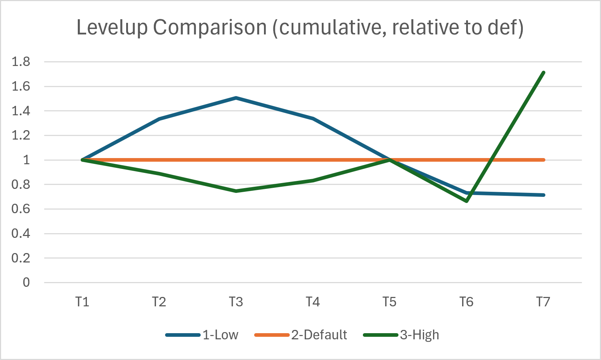
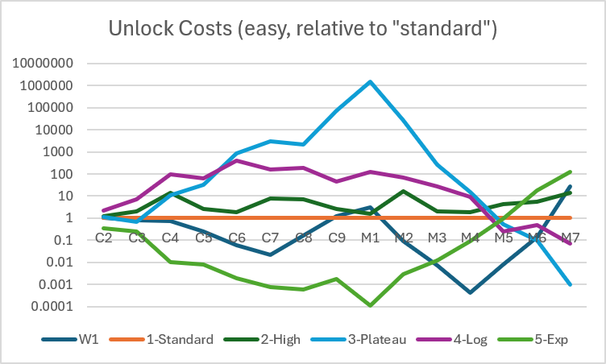

This mostly contains copies of posts from the idle1 discord.  Over time,
hopefully I will make it more guide-like.

[Information about EX that is obsolete](obs_ex.md)

### 6/11/26

I just measured 20 color 1 completions:
- without manual: 87s
- with manual (not used): 87s
- with manual (held): 47s
- with manual (tapped): 53s

[This has all been fixed] ~~The in-game profit reporting looks incorrect to me.  I think it’s using 4s (rather than ~4.35) for the base.  It then shows 7x speedup rather than not quite 2x.  It also omits the small (1+), fixed bonus due to EX that we see.~~

Time bomb on C1 takes about 25s.  So it’s 5-6x slower.  Income goes from 4 to 576, which 144x.  (Manual cuts the time in about half.)

### 6/12/26

I’ve been collecting data on completion rounds and times, and I’m convinced that with enough EX, short EX resets are far more efficient.  There are three main factors for this:
- The initial reset amount (0.05) is bigger than incremental gains (0.01 for 2 POW).
- Short resets don’t take all that many rounds (or time).  Beat W1 1-3 times to provide a boost to help with the W1-W7 run.
- Although the worlds in long resets get faster as POW goes up, they are limited by the first round in a world not getting any benefit from pow.  Specifically, W1R1 takes 1:40+ so these fast runs can’t get faster than that.

Putting it together, 0.05 EX is 100 W1s, and this can’t get much faster than 3 hours.  If a short reset takes less than this, short wins.  The question then becomes how much EX is needed for this to happen.

### 6/26/26

For a given earn_prestige value, your multiplier compared to before will be approximately

$$\text{earn}^{new - old}$$

### 7/2/26

I’ve been collecting a bunch of other data that I can start posting here.  Mostly this is for easy difficulty, but some things are unchanged and some have simple multipliers.  Corrections welcome!

First, prestige values (same for all difficulties?)  Note that the curves start (C5) at the opposite of the name but finish (upper machines) as stated.  Machine 7 isn’t useful since the level is finished.

{: .right-table}

|    | Low  | Med  | High |
| -: | ---: | ---: | ---: |
| C5 |    5 |    2 |    1 |
| C6 |   27 |    5 |    4 |
| C7 |  150 |   36 |   16 |
| C8 |  720 |  100 |   72 |
| C9 |   3k |  480 |  300 |
| M1 |   8k |   2k |   1k |
| M2 |  25k |   9k |   8k |
| M3 |  72k |  35k | 100k |
| M4 | 196k | 123k | 500k |
| M5 | 500k |   1M |   2M |
| M6 |   1M |   5M |  16M |
| M7 |   3M |  24M |  80M |

Each color has a base value for earn, multiplied by the number of that color that has been purchased.  A multiplier comes from the tier of purchases (like 10-25-50).  The different multiplier ranges only change when the tier changes, not the multiplier itself.  Here are the values, many rounded:

{: .right-table}

|Tier| 10-25 | 10-20 | 10-50 |   Low |   Def |  High |
| -: | ----: | ----: | ----: | ----: | ----: | ----: |
| T1 |   10  |   10  |   10  |     3 |     3 |     3 |
| T2 |   25  |   20  |   50  |     8 |     6 |  5.33 |
| T3 |   50  |   30  |  100  |    25 |    22 |  18.5 |
| T4 |  100  |   60  |  150  |   133 |   150 |   167 |
| T5 |  200  |  120  |  200  |  1260 |  1680 |  2025 |
| T6 |  300  |  240  |  250  | 21800 | 29800 | 19800 |
| T7 |  400  |  480  |  300  | 45900 | 47000 |  121k |

More interesting, perhaps, are the cumulative multipliers (using in-game e notation, not scientific):

{: .right-table}

|Tier| 10-25 | 10-20 | 10-50 |   Low |   Def |  High |
| -: | ----: | ----: | ----: | ----: | ----: | ----: |
| T1 |   10  |   10  |   10  |     3 |     3 |     3 |
| T2 |   25  |   20  |   50  |    24 |    18 |    16 |
| T3 |   50  |   30  |  100  |   600 |   396 |   296 |
| T4 |  100  |   60  |  150  |   79k |   59k |   49k |
| T5 |  200  |  120  |  200  |  100M |  100M |  100M |
| T6 |  300  |  240  |  250  |  2.2T |    3T |    2T |
| T7 |  400  |  480  |  300  | 100e1 | 140e1 | 240e1 |

Here are the cumulative values charted as a ratio compared to the default setting.  Like the prestige values, low and high start backwards from their names, all line up at the 5th upgrade, and then end up as their names suggest.

Tier 6 under the high setting might be a mistake.

The high fixed costs setting adds a 5x multiplier to C8 and 8x to C9.

The value is also multiplied by the number purchased of that color and the bonus from earn/speed/EX.

### 7/3/26

We've been given that for earn:

$$\text{earn}_\text{net} = \text{earn}_\text{base} * (1 + 0.3 * \text{speed}^\text{EX} + 3.0 * \text{earn}^\text{EX})$$

EX here is 1.14 plus earned EX (equivalently, the EX shown in the creation room plus 0.14).

I'd guess that speed and cost follow a similar pattern but haven't computed them.  The constants could vary.

Earn base values (rounded, in-game e notation):

{: .right-table}

|    | $\text{earn}_\text{base}$ |
| -: | --------: |
| C1 |       4   |
| C2 |     413   |
| C3 |   17880   |
| C4 |   1.27M   |
| C5 |  97.44M   |
| C6 |   8.65B   |
| C7 |    882B   |
| C8 |    100T   |
| C9 | 12.76e1   |

### 7/8/26

The impact of the speed boost is more complicated.  Taking some times involves measurement error, and the upper colors are slow to wait for.  However, I believe the speed value follows the pattern for earn, and my guess is

$$\text{speed}_\text{net} = \text{speed}_\text{base} * (1 + 0.6 * \text{speed}^\text{EX})$$

where EX is again 1.14 plus earned EX (equivalently, the EX shown in the creation room plus 0.14).

The impact of speed on earn matches the curve given by the formula (so, 1/10 of the impact of earn)

$$\text{earn}_\text{net} = \text{earn}_\text{base} * (1 + 0.3 * \text{speed}^\text{EX} + 3.0 * \text{earn}^\text{EX})$$

The maximum speed is 0.3 seconds/completion
(equivalently, 200 completions per minute).

However...

... there is some sort of separate penalty to earn applied.  You can see this by applying 1 speed to a color and noting that the earn goes down.  (prestige for 1 by using "high prestige curve" and resetting at C5, higher prestiges work too)

A portion of this penalty persists after hitting max speed.  However, the penalty stops going up.  If earn and speed are roughly the same (like if both are infinity), then the overall impact of speed actually reduces earn.  However, the increase in speed itself of course makes up for it.

The penalty seems to be independent of EX and color and only dependent on the speed_prestige value.  The penalty at max speed seems to be independent of EX but dependent on color.  (But, EX causes speed to max out earlier.)

The best formula that I've found to model the penalty is dividing earn by

$$1 + 0.462 * \text{speed}^{0.816 * EX + 0.039}$$

I don't think this is the actual formula, but it is close for the values that I've seen.  A few values: at 0 it is 1 (no penalty), at 1 it is ~0.68, 2 is ~0.51, 10 is ~0.18, 50 is ~0.05.

When speed is maxed, the penalty is around 40% less than where it maxed for that color.  C1 is ~0.4, C5 is ~0.11, C8 is ~0.07.

### 7/18/26

Some more game data:

Cost seems to have the most variation in the game.  The costs setting gives six different shapes to costs, and cost is how the five difficulty levels impact the game.  The K factor also imnpacts costs.  Each color is a bit different.

First, the simplest thing to explain is probably the cost prestige.  It is similar to the others.  Cost is divided by

$$1 + 3 * \text{cost}^\text{EX}$$

The minimum cost is 1.

Each purchase of a color increases the cost of the next purchase by a multiplier.  The multipliers vary by color and K factor.

{: .right-table}

|    | $\text K_\text{low}$ | $\text K_\text{med}$ | $\text K_\text{high}$ |
| -: | -------: | -------: | -------: |
| C1 |      14% |     15%  |      16% |
| C2 |   17.05% |   18.1%  |   19.15% |
| C3 |   19.10% |  20.18%  |   21.28% |
| C4 |   21.15% |   22.3%  |   23.45% |
| C5 |   23.20% |   24.4%  |   25.60% |
| C6 |   25.25% |   26.5%  |   27.75% |
| C7 |   27.30% |   28.6%  |   29.90% |
| C8 |   29.35% |   30.7%  |   32.05% |
| C9 |   31.40% |   32.8%  |   34.20% |

So basically, each color is 2.05%/2.1%/2.15% ($\text K_\text{low}$/$\text K_\text{med}$/$\text K_\text{high}$) worse than the one before it _except_ that C1 to C2 is 3.05%/3.1%/3.15% and C3 is slightly off.  Maybe there's a simpler explanation, but this matches the data well.

Because these multipliers compound, the effects of $\text K_\text{low}$ and $\text K_\text{high}$ compared to $\text K_\text{med}$ are more pronounced after more purchases.  For example, the change in cost to get up to 10 of a color is less than 10%, but the change in cost for the final levelup is over 100x.

For each world and color, we also need a starting point.  C1 is special.  It seems to have values assigned for each level rather than using multipliers across world settings.  The table below gives the cost for a hypothetical purchase number zero.  Therefore, the initial purchase in the game (number two) is found by applying the above multiplier twice.

{: .right-table}

|        | W1 | Std | High | Plateau | Log | Exp |
| :----- | -: | --: | ---: | ------: | --: | --: |
| Easy   |  2 |  2  |    2 |       2 |   2 |   2 |
| Normal |  3 |  4  |    6 |       4 |   7 |   2 |
| Hard   |  3 |  4  |    7 |       4 |   8 |   2 |
| Crazy  |  4 |  6  |    9 |       6 |  10 |   3 |
| Evil   |  8 | 12  |   18 |      12 |  20 |   6 |

### 7/19/26

Here are the unlock costs for each cost type under easy difficulty.  Note that 'e' here means scientific notation, not the in-game notation.

{: .right-table}

|  |      W1 |     Std |    High | Plateau |     Log |     Exp |
|- | ------: | ------: | ------: | ------: | ------: | ------: |
|C2|      41 |      40 |      50 |      46 |      86 |      14 |
|C3|     157 |     199 |     398 |     141 |    1430 |      48 |
|C4|    398k |    540k |   7.39M |   5.73M |   51.2M |    5350 |
|C5|   66.9M |    269M |    684M |   8.46B |   17.4B |   2.08M |
|C6|    6.4B | 1.11e11 | 2.11e11 | 9.03e13 | 4.32e13 |    217M |
|C7| 1.1e13  | 5.18e14 | 4.02e15 | 1.52e18 | 8.4e16  | 3.86e11 |
|C8| 7.86e16 | 4.98e17 | 3.48e18 | 1.1e21  | 9.25e19 | 2.92e14 |
|C9| 1.84e20 | 1.49e20 | 3.99e20 | 1.1e25  | 6.69e21 | 2.55e17 |
|M1| 8.12e23 | 2.58e23 | 4.08e23 | 3.91e29 | 3.07e25 | 2.81e19 |
|M2| 1.19e25 | 1.31e26 | 2.24e27 | 3.35e30 | 8.61e27 | 3.84e23 |
|M3| 3.6e26  | 5.04e28 | 1e29    | 1.31e31 | 1.43e30 | 6.35e26 |
|M4| 6.06e27 | 1.44e31 | 2.66e31 | 2.2e32  | 1.36e32 | 1.26e30 |
|M5| 2.36e31 | 2.98e33 | 1.24e34 | 1.54e33 | 7.26e32 | 2.92e33 |
|M6| 5.88e34 | 4.38e35 | 2.42e36 | 4.29e34 | 2.1e35  | 7.91e36 |
|M7| 1.23e40 | 4.48e38 | 6.34e39 | 4.6e35  | 3.24e37 | 5.58e40 |

Starting with standard, to calculate other costs, use the unlock cost as a hypothetical purchase number zero.  Therefore, the second purchase for a color has a "double multiplier" applied to it.  The third and following purchases use the normal multiplier for that color.

However, the numbers for C2 standard don't quite work out this way.  Instead, use $47$ as the cost for a hypothetical purchase number one and go from there.

For other cost settings, the unlock values can probably still be used as a "cost zero".  However, C2 is still strange, and the best method so far is to take $47$ as "cost one" and multiply it by the difference seen.  Therefore, for "High", use $47 * 1.25$ for "cost one".

Here is a visualization of the costs relative to "standard":

For other difficulty levels, use the previous chart for C1.  For other colors, use multipliers on the easy values.  The multipliers vary by color.

For normal, C2-C5 are 6x, and C6-C9 and M1-M7 are 20x.  Except: exponential M7 is 22.22x and W1 M7 is 26.5x.

For hard, C2 is 6.7x, C3-C5 are 21x, C6-C9 are 160x, M1-M5 are around 197x, M6 is 1970x, and M7 is 23500x.  Except: logarithmic M6 is 19700x, plateau W7 is 25600x, and again for M7, exponential (26100x) and W1 (31100x) are larger.

For crazy, C2 is 7.5x, C3-C5 are 87x, C6-C9 are 1700x, M1-M5 are 2650x, M6 is 26500x, and M7 is 75Mx.  Except: plateau M7 is 750Mx, and again for M7, exponential (81Mx) and W1 (104Mx) are larger.

Evil has different boosts for each color, which is why each color and machine is _much_ harder to reach compared to other levels.  "e" representation normal scientific notation, not in-game "e" notation.

{: .right-table}

|  | Cost Mult | Exceptions |
|--| --------: | :--------- |
|C2|      22.8 |
|C3|      3500 |
|C4|      5200 |
|C5|      8600 | plateau and log are 86000
|C6|     25500 |
|C7|     42500 |
|C8|       68M |
|C9|   1.36e15 | W1 is 1.36e14
|M1|      4e16 | exp is 4e17, plat/log are 4e25
|M2|      8e26 | log/exp are 8e27
|M3|    1.6e36 | log/exp are 1.6e37
|M4|    5.3e46 |
|M5|    2.1e49 |
|M6|    1.3e61 |
|M7|    7.5e86 | W1 is 1e87, plat is 7.5e87

### 10/31/26

CMax posted a question about prestige values.
The manual gives the following prestige formula:

$$\text{prestige}=\text{base}^{\text{POW}} + (\text{POW}-1) * 20$$

However, with a base value of $2$ and a POW of $2.8$,
the game gives $45$ when the manual predicts $\lceil 42.96\rceil=43$.

Some other values are also slightly too large.
None appear to be too small.
Here are the prestige values for the medium prestige curve
for POWs from 1 to 3.
A red value indicates one that is
two larger than the formula gives.
A blue value indicates one that is
one larger than the formula gives.
Note that once the values reach 1000,
the displayed values are rounded and hide small differences.

{: .right-table}

|POW|C5|C6 |C7 |C8  |C9  |M1  |M2  |M3  |M4  |M5  |M6  |
| -:|-:|-: |-: |-:  |-:  |-:  |-:  |-:  |-:  |-:  |-:  |
|1  |2 |5  |36 |100 |480 |2k  |9k  |35k |123k|1M  |5M  |
|1.1|5 |8  |55|162|892 |4k  |22k |99k |397k|3M  |23M |
|1.2|8|12|78 |256 |1k  |9k  |55k |283k|1M  |15M |109M|
|1.3|10|15 |112|405 |3k  |19k |138k|807k|4M  |63M |511M|
|1.4|12|18 |160|640|5k  |41k |343k|2M  |13M |251M|2B  |
|1.5|15|22 |228|1k  |10k |89k |853k|6M  |43M |1B  |11B |
|1.6|16|26 |322|1k  |19k |191k|2M  |18M |139M|3B  |52B |
|1.7|18|30 |458|2k  |36k |409k|5M  |53M |449M|15B |244B|
|1.8|20|35 |650|3k  |67k |874k|13M |151M|1B  |63B |1T  |
|1.9|22|40 |925|6k  |124k|1M  |32M |430M|4B  |251B|5T  |
|2.0|25|46|1k |10k |230k|4M  |81M |1B  |15B |1T  |25T |
|2.1|28|52|1k |15k |427k|8M  |201M|3B  |48B |3T  |116T|
|2.2|30|60|2k |25k |792k|18M |500M|9B  |157B|15T |546T|
|2.3|32|68|3k |39k |1M  |39M |1B  |28B |509B|63T |2Q  |
|2.4|35|76 |5k |63k |2M  |83M |3B  |80B |1T  |251T|11Q |
|2.5|36|86 |7k |100k|5M  |178M|7B  |229B|5T  |1Q  |55Q |
|2.6|40|98 |11k|158k|9M  |382M|19B |652B|17T |3Q  |$\infty$|
|2.7|42|112|15k|251k|17M |818M|47B |1T  |55T |15Q |$\infty$|
|2.8|45|128|22k|398k|32M |1B  |117B|5T  |178T|63Q |$\infty$|
|2.9|46|145|32k|630k|59M |3B  |293B|15T |576T|$\infty$|$\infty$|
|3  |50|166|46k|1M  |110M|8B  |729B|42T |1Q  |$\infty$|$\infty$|
